  

  

  
  
  
  
  

  Final-year B.Tech CSE student at <strong>Parul University</strong> building production-grade <strong>MERN / TypeScript</strong> applications, real-time <strong>Computer Vision</strong> systems, and <strong>RAG-powered AI agents</strong>. Actively seeking <strong>SDE</strong> roles.

---

<h3><code>mrpandeyshubham@github ~ $ whoami</code></h3>

<table>
  <tr>
    <td valign="top"></td>
    <td valign="top"></td>
  </tr>
</table>

 

<h3><code>mrpandeyshubham@github ~ $ ./contributions.sh --live</code></h3>

 

 
100% self-hosted SVGs — automatically synced every 4 hours by <a href="./.github/workflows/update-profile-art.yml">GitHub Actions</a> from live GitHub, LeetCode &amp; CodeChef data.

---

## 🚀 Flagship Projects

<table>
  <tr>
    <td>
      <h3>👁️ TrueEyeball — Real-Time Eyeball &amp; Gesture HCI Platform</h3>
      

        AI-powered, touchless Human–Computer Interaction desktop platform combining <strong>OpenCV</strong> and <strong>MediaPipe</strong> facial &amp; 21-point hand landmark pipelines. Features user-adaptive EAR blink detection, a temporal gesture state machine, EMA + velocity cursor stabilization, Fernet-encrypted biometric face authentication with continuous presence monitoring, and an <strong>SQLite + CustomTkinter</strong> Smart Library &amp; Study Notes suite with RBAC and OpenPyXL Excel reporting.
      

      

        <strong>Stack:</strong> <code>Python 3.11+</code> · <code>OpenCV</code> · <code>MediaPipe</code> · <code>CustomTkinter</code> · <code>SQLite</code> · <code>OpenPyXL</code> · <code>PyTest</code>
      

      

        
        
      

    </td>
  </tr>
  <tr>
    <td>
      <h3>🧾 UniBill — Production-Grade GST Billing, POS &amp; Inventory ERP</h3>
      

        Full-stack GST Billing, Point of Sale, and Inventory ERP engineered for real concurrency and transactional safety. Implements automated <strong>CGST / SGST / IGST</strong> computation, atomic financial-year invoice numbering inside <strong>MongoDB</strong> transactions, JWT refresh-token auth with RBAC, Zod request validation, GSTR-1 style tax reports with CSV export, Recharts analytics, OpenAPI/Swagger docs, Vitest + <code>mongodb-memory-server</code> tests, and Docker Compose deployment.
      

      

        <strong>Stack:</strong> <code>React 18</code> · <code>Vite</code> · <code>Tailwind CSS</code> · <code>Node.js 20</code> · <code>Express 4</code> · <code>MongoDB 7</code> · <code>Docker</code> · <code>Vitest</code>
      

      

        
        
      

    </td>
  </tr>
  <tr>
    <td>
      <h3>💰 BachatPay AI — Multilingual Financial Literacy RAG Agent</h3>
      

        Cognitive AI financial assistant built during the <strong>IBM SkillsBuild for Academia Internship</strong> to simplify digital finance literacy (UPI safety, loans, savings, and budgeting) in <strong>English &amp; Hindi</strong>. Grounded in verified <strong>RBI, NPCI &amp; SEBI</strong> documentation using an <strong>IBM Watsonx.ai</strong> vector index RAG pipeline and <strong>IBM Granite LLM</strong> with context-aware filtering on <strong>IBM Cloud</strong>.
      

      

        <strong>Stack:</strong> <code>IBM Watsonx.ai</code> · <code>IBM Granite LLM</code> · <code>RAG</code> · <code>Vector Index</code> · <code>Python</code> · <code>IBM Cloud</code>
      

      

        
      

    </td>
  </tr>
</table>

<strong>More Notable Projects</strong> — ERP-CRM (TypeScript/PostgreSQL) &amp; ₹upiya Budget (Live on Vercel)

 
<table>
  <tr>
    <td width="50%">
      <strong>📦 Mini ERP + CRM Portal</strong> 
      Wholesale ERP/CRM with role-based auth, customer CRM, inventory, and stock-safe sales challans.  
      <code>TypeScript</code> · <code>React 19</code> · <code>Express 5</code> · <code>Prisma</code> · <code>PostgreSQL</code>  
      
    </td>
    <td width="50%">
      <strong>💸 ₹upiya Budget</strong> 
      Diary-style personal finance &amp; friend-udhaar tracker with smart auto-categorization.  
      <code>React</code> · <code>Node.js</code> · <code>Express</code> · <code>MongoDB</code> · <code>Vercel</code>  
      
      
    </td>
  </tr>
</table>

> Explore all repositories → [**github.com/mrpandeyshubham**](https://github.com/mrpandeyshubham?tab=repositories)

---

## 🛠️ Tech Stack

  

  

  <strong>AI &amp; Vision:</strong> OpenCV · MediaPipe · IBM Watsonx.ai · Granite LLM · RAG Pipelines 
  <strong>Cloud &amp; Engineering:</strong> IBM Cloud · Google Cloud · Vercel · Docker · GitHub Actions · DSA · System Design

---

## 🏆 Achievements & Certifications

| Category | Highlights |
| --- | --- |
| **Competitive Programming** | **LeetCode:** 1753 rating · 296+ solved · 25 contests &nbsp;|&nbsp; **CodeChef:** 1431 rating · 9+ contests &nbsp;|&nbsp; Tracked on [Codolio](https://codolio.com/profile/ShubhamPandey) |
| **Hackathons** | 🏅 **Vadodara Hackathon 6.0 (2025)** — CuraBot AI &nbsp;·&nbsp; 🏅 **Build With India (2025)** &amp; **Hack The Mountains 5.0 (2024)** |
| **Certifications** | AI Fundamentals with IBM SkillsBuild (Cisco) &nbsp;·&nbsp; React.js Web Development (Parul University) &nbsp;·&nbsp; Java Technology Stack (Infosys Springboard) |

---

  

